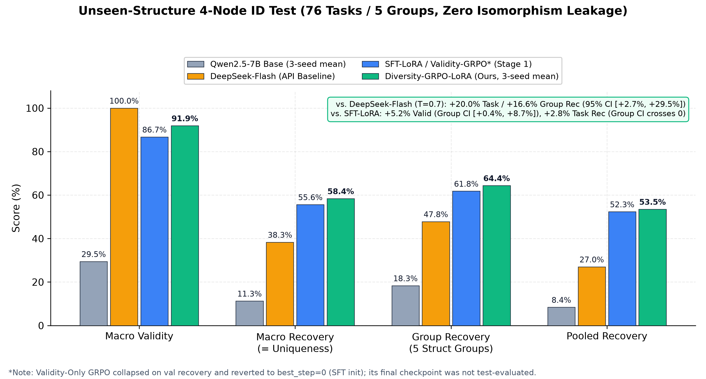
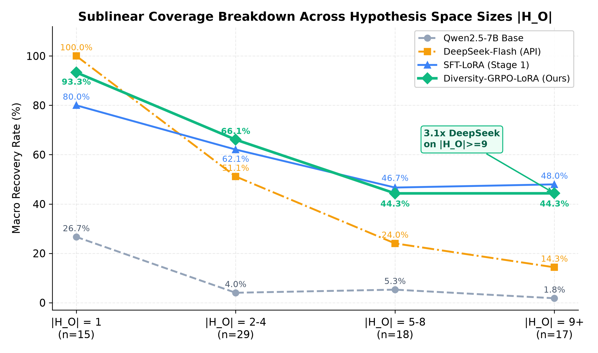
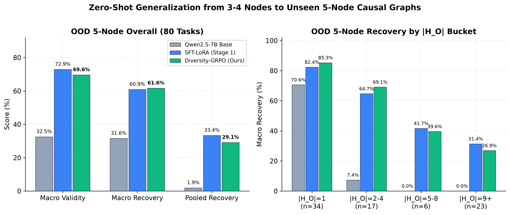
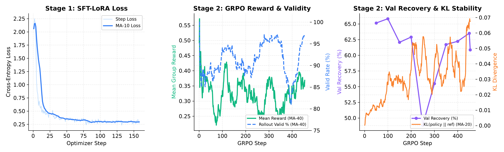
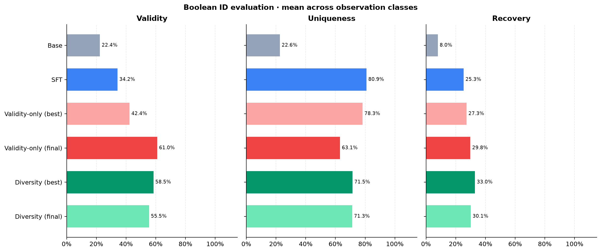
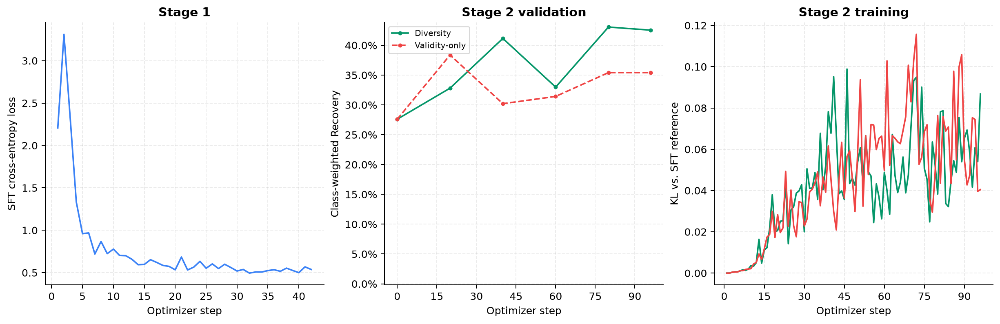
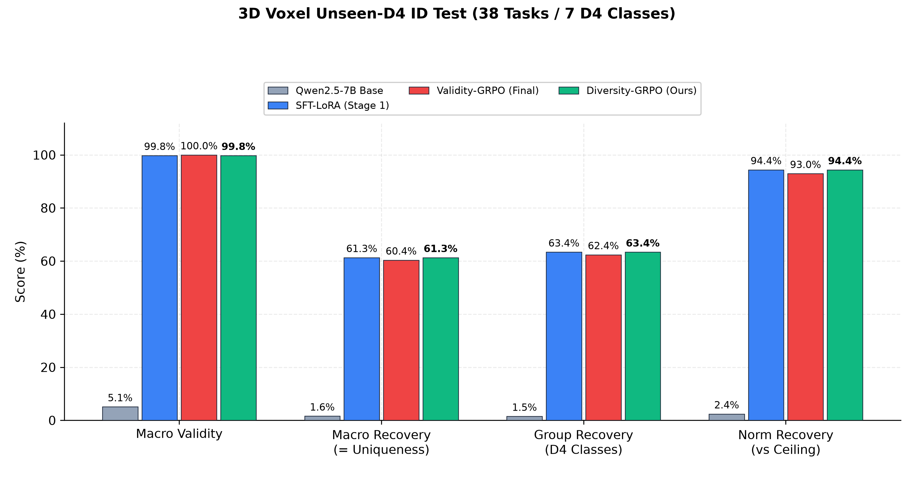
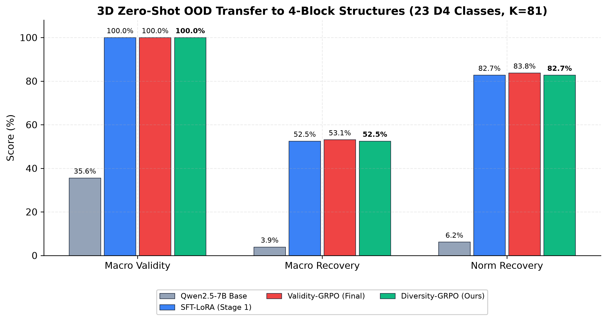

# EEC 4300 Final Project — Breaking Sublinear Coverage in HypoSpace via Two-Stage Diversity-Aware GRPO-LoRA

> **Language**: **English** | [简体中文](README_ZH.md)

This repository contains our **EEC 4300** group project on **HypoSpace** (*ICML 2026*, [PMLR Vol. 306](https://proceedings.mlr.press/v306/chen26bz.html)), which evaluates LLMs as samplers over **underdetermined scientific hypothesis spaces** using three metrics: **Validity**, **Uniqueness**, and **Recovery**.

---

## 1. Problem & Motivation

Under HypoSpace's formal **Fixed-Prompt** independent sampling protocol (`--independent-samples`, $N = |H_O|$ queries per task without appending prior proposals into the prompt), even strong closed-source LLMs suffer severe **mode collapse** and **sublinear coverage**: as the hypothesis space size $|H_O|$ increases, the number of recovered valid graphs grows sublinearly relative to $|H_O|$, so Recovery drops sharply with problem ambiguity (see Fig. 2).

- On our unseen-structure 4-node causal test split, teammates' pre-recorded **`DeepSeek-Flash`** API baseline (`T = 0.7`, sliced from the full 392-task run in [full_repo_causal_n4_obs3_deepseek.json](HypoSpace-release/causal/benchmark_obs_count/full_repo_causal_n4_obs3_deepseek.json)) achieves **100.00% Validity**, but its **Recovery drops to 38.34%** (and falls to **18.52%** when $|H_O| \ge 9$).
- Standard supervised fine-tuning (**SFT-LoRA**) improves reachability and accounts for most of the raw Recovery gain over `DeepSeek-Flash`, yet lacks a set-level anti-repetition objective. Meanwhile, a naive **Validity-Only GRPO** ablation collapses toward a narrow set of safe solutions (`Val Valid`: 77.52% → 96.27%, while `Val Group Recovery` drops 55.82% → 52.17%).

We propose **Two-Stage Diversity-Aware GRPO-LoRA** on `Qwen2.5-7B-Instruct` under a **zero-isomorphism-leakage split** and a unified Qwen sampling configuration (`T = 0.9, top_p = 0.95`), reshaping the sampler's internal distribution without prompt-history tricks or verifier-feature leakage.

---

## 2. Headline Results (v2.1 Zero-Isomorphism-Leakage Protocol)

### 2.1 Zero-Isomorphism-Leakage Split & Finite-Sample Reference Ceilings

All 392 tasks in `n4_obs3_all.json` reduce to **22 node-permutation ($S_4$) isomorphism equivalence classes** under canonical observation signatures (`canonical_isomorphism_key` in [data_utils.py](HypoSpace-release/causal/grpo_lora/data_utils.py)). We split **entire equivalence classes** into:
- **Train**: `13` groups (`256` `n=4` + `19` `n=3` = `275` tasks)
- **Val**: `4` groups (`60` tasks; `48` stratified tasks = `12/group` used for balanced validation)
- **Unseen-Structure ID Test**: `5` groups (`76` tasks, `400` queries)

Under Fixed-Prompt sampling with $K = |H_O|$ independent uniform draws, the **expected recovery reference ceiling under i.i.d. uniform sampling** (*finite-sample reference ceiling*) is $1 - (1 - 1/K)^K$ (`70.38%` macro across the 76 ID tasks; `81.41%` across the 80 OOD 5-node tasks). Because this is an i.i.d. expectation rather than a hard cap, individual tasks or small structure groups can exceed `100%` of the reference ceiling (e.g., OOD `G15` reaches `133.33%` and `G09` reaches `109.71%` in [ood_n5_v2_stats.md](results_analysis/ood_n5_v2_stats.md)). We report both **raw** and **ceiling-normalized** recovery (`recovery_norm`), alongside **isomorphism-group cluster bootstrap 95% CIs (10,000 resamples)** via [group_stats.py](results_analysis/group_stats.py).

### 2.2 Unseen-Structure 4-Node ID Test (76 Tasks / 5 Groups)

Each Qwen method is **trained once**; Qwen results below average across **3 evaluation sampling seeds** (`33550336, 1, 2`, `T = 0.9, top_p = 0.95`), reflecting sampling variance rather than training-seed variance. `DeepSeek-Flash` comes from teammates' existing 392-task run (`T = 0.7`, [config_deepseek.yaml](HypoSpace-release/causal/config/config_deepseek.yaml)) aligned to the same 76 tasks.

| Model / Method | Eval Runs | Parse | Macro Valid | **Macro Rec (= Uniq)** | Task Norm Rec | **Group Rec (mean ± std)** | Group Norm Rec | **Pooled Rec** |
|---|---:|---:|---:|---:|---:|---:|---:|---:|
| `Qwen2.5-7B Base` (Zero-shot, `T=0.9`) | 3 eval seeds | 100.00% | 29.47% | 11.29% | 14.97% | 18.34% ± 22.45% | 21.26% ± 20.89% | 8.42% |
| `DeepSeek-Flash` (Closed API, `T=0.7`) | 1 existing run | **100.00%** | **100.00%** | 38.34% | 52.47% | 47.80% ± 33.61% | 59.40% ± 31.47% | 27.00% |
| `SFT-LoRA` (`= Validity-GRPO best`)* | 3 eval seeds | 97.69% | 86.71% | 55.63% | 78.70% | 61.81% ± 17.15% | 81.26% ± 6.98% | 52.33% |
| **`Diversity-GRPO-LoRA` (Ours, `T=0.9`)** | 3 eval seeds | 98.42% | **91.91%** | **58.38%** | **82.50%** | **64.37% ± 16.88%** | **84.78% ± 8.10%** | **53.50%** |

*\*Notes: (1) Because each task issues $N = |H_O|$ queries and `ground_truth_graphs` is exhaustive, `Uniqueness` and `Recovery` are numerically identical. (2) `Validity-Only GRPO` collapsed on validation (`Val Group Recovery` dropped from `55.82%` to `52.17%`, Fig. 4) and triggered `best_step == 0` protection; therefore this row evaluates the retained SFT initialization weights, and `Validity-Only`'s final checkpoint was not test-evaluated.*

- **Gain attribution & statistical comparison ([id_v2_stats.md](results_analysis/id_v2_stats.md))**:
  - **Primary source of ID gain**: On the 4-node ID test, most of the `+20.04%` Task Recovery gain over `DeepSeek-Flash` comes from **Stage 1 SFT** (`+17.29%`, Group `+14.00%`). Stage 2 `Diversity-GRPO` adds `+2.75%` Task / `+2.56%` Group Recovery consistently across all 3 evaluation seeds (`57.75% vs 54.20%`, `58.13% vs 54.33%`, `59.27% vs 58.35%`), though the group-level Recovery CI `[-0.31%, +5.43%]` crosses 0 due to low statistical power ($n = 5$ test groups). By contrast, Stage 2's **+5.20% Task / +4.46% Group Validity** gain over SFT is statistically significant (95% CI **`[+0.42%, +8.73%]`**). Stronger evidence for Stage 2's diversity benefit appears in the 22-group OOD 5-node evaluation below.
  - `Diversity-GRPO-LoRA` vs. `DeepSeek-Flash`: **+20.04%** Task Recovery (`57` wins / `11` ties / `8` losses), **+16.57%** Group Recovery (Cluster Bootstrap 95% CI **`[+2.71%, +29.52%]`**, Group Norm **+25.38%**, CI `[+6.27%, +44.49%]`).

#### Recovery Breakdown by Hypothesis Space Size $|H_O|$

| Bucket (`\|H_O\|`) | Tasks (Groups) | Reference Ceiling | `Base 7B` | `DeepSeek-Flash` | `SFT-LoRA` | **`Diversity-GRPO-LoRA`** | Norm Rec (Ours) |
|---|---:|---:|---:|---:|---:|---:|---:|
| `1` | 4 (1) | 100.00% | 58.33% | **100.00%** | 91.67% | **91.67%** | 91.67% |
| `2–4` | 36 (2) | 71.91% | 10.03% | 51.85% | 57.10% | **63.43%** | **88.22%** |
| `5–8` | 24 (1) | 65.64% | 8.51% | 17.71% | **47.92%** | 46.53% | 70.88% |
| **`9+` (Hardest)** | 12 (1) | 65.36% | 4.94% | 18.52% | 54.63% | **55.86%** | **85.48%** |

*On `9+` (`12` tasks, `1` structure group), **both SFT (`54.63%`) and Diversity-GRPO (`55.86%`) achieve ~3x `DeepSeek-Flash` (`18.52%`)**.*

<p align="center">
  
  
</p>

### 2.3 Out-of-Distribution 5-Node Transfer (80 Tasks / 22 Structure Groups)

Evaluated zero-shot on unseen 5-node causal systems using a **single evaluation seed (`33550336`, `T = 0.9, top_p = 0.95`)** on [n5_obs5_hybrid80.json](HypoSpace-release/causal/datasets/n5_obs5_hybrid80.json) (80 tasks, 22 structure groups, Reference Ceiling `81.41%`) and [causal_n5_gt160.json](HypoSpace-release/causal/benchmark_obs_count/paper_scale/causal_n5_gt160.json) (7 tasks, $|H_O|=160$):

| Dataset | Model | Macro Valid | **Macro Rec (= Uniq)** | **Group Rec (mean ± std)** | Group Norm Rec | **Pooled Rec** | `Bucket 9+` Rec |
|---|---|---:|---:|---:|---:|---:|---:|
| `n5_obs5_hybrid80` (80 tasks) | `Qwen2.5-7B Base` | 28.14% | 26.58% | 17.78% ± 33.72% | 18.71% ± 33.90% | 1.69% | 0.07% |
| `n5_obs5_hybrid80` (80 tasks) | `SFT-LoRA` (`= Validity-GRPO*`) | 67.54% | 56.97% | 50.92% ± 28.47% | 61.69% ± 26.17% | 28.28% | 26.43% |
| `n5_obs5_hybrid80` (80 tasks) | **`Diversity-GRPO-LoRA` (Ours)** | **70.33%** | **61.70%** | **63.21% ± 26.63%** | **78.17% ± 24.67%** | **31.38%** | **29.28%** |
| `causal_n5_gt160` (7 tasks, `\|H_O\|=160`) | **`Diversity-GRPO-LoRA` (Ours)** *(no baseline; stress-test ref)* | 19.29% | 10.71% | — | — | 10.71% | 10.71% |

- **Significant across 22 structure groups (single eval seed, [ood_n5_v2_stats.md](results_analysis/ood_n5_v2_stats.md))**:
  - `Diversity-GRPO-LoRA` vs. `SFT-LoRA`: **+4.73%** Task Macro Recovery, **+3.10%** Pooled Recovery, and **+12.29% ± 24.88%** Structure-Group Recovery (**12 wins / 8 ties / 2 losses**, exact two-sided binomial sign test **$p = 0.0129$**, Cluster Bootstrap 95% CI **`[+3.50%, +23.68%]`**). Group Norm Recovery improves by **+16.49%** (95% CI **`[+5.01%, +31.49%]`**), winning across every multi-solution bucket (`2–4`: `63.24% vs 47.06%`, `5–8`: `47.92% vs 41.67%`, `9+`: `29.28% vs 26.43%`). Note that group sizes are uneven (11 of the 22 groups contain 1 task, while `G22` contains 19 tasks).
  - **Single-solution (`|H_O|=1`) trade-off**: On the largest single-solution group `G02` (`13` tasks), `Diversity-GRPO` scores **76.92%** vs. `SFT` **92.31%**, offset by gains on `G03` (`100.00% vs 66.67%`) and `G04` (`100.00% vs 75.00%`), leaving the overall `|H_O|=1` bucket mean tied at `85.29%`.
  - `Diversity-GRPO-LoRA` vs. `Base 7B`: **+45.43%** Group Recovery (19 wins / 3 ties / 0 losses, sign test **$p < 10^{-4}$**, 95% CI `[+33.81%, +57.77%]`).

<p align="center">
  
  
</p>

---

### 2.4 Cross-Domain Extension: Boolean Genetic Interaction & 3D Voxel Reconstruction

To evaluate whether Two-Stage Diversity-Aware GRPO-LoRA generalizes beyond Causal graphs, we implemented zero-isomorphism-leakage splits and ran full RTX 5090 `Qwen2.5-7B-Instruct` ablations (`Base`, `SFT`, `Validity-Only`, `Diversity-GRPO`, `T=0.9, top_p=0.95`) on **Boolean** and **3D**.

#### 2.4.1 Boolean Genetic Interaction ([id_boolean_stats.md](results_analysis/id_boolean_stats.md), [ood_boolean_stats.md](results_analysis/ood_boolean_stats.md))

- **Zero-overlap splits (`x/y` symmetry)**: `train` (`66` tasks / `30` equiv classes), `val` (`14` tasks / `8` classes), **ID Test** (`19` tasks / `13` classes, 3 eval seeds, ceiling `69.03%`), and **Full-NOR OOD** ([boolean_full_d2.json](HypoSpace-release/causal/benchmark_obs_count/paper_scale/boolean_full_d2.json), `80` tasks / `53` classes including unseen `NOR`, single eval seed, ceiling `66.76%`).
- **ID Test (19 Tasks / 13 Groups / 3 Eval Seeds)**:

| Model | Eval Seeds | Task Valid | Task Uniq | **Task Macro Rec** | Task Norm Rec | **Group Rec (mean ± std)** |
|---|---:|---:|---:|---:|---:|---:|
| `Qwen2.5-7B Base` | 3 | 20.70% | 24.22% | 7.64% | 11.38% | 7.97% ± 10.03% |
| `SFT-LoRA` | 3 | 30.89% | **82.44%** | 22.90% | 34.52% | 25.31% ± 19.04% |
| `Validity-Only (best / step 20)` | 3 | 38.94% | 79.42% | 24.36% | 36.70% | 27.32% ± 18.58% |
| `Validity-Only (final)` | 3 | **59.12%** | 62.77% | 27.89% | 41.10% | 29.83% ± 14.21% |
| **`Diversity-GRPO (best / step 80)`** | 3 | 54.16% | 73.50% | **31.16%** | **46.23%** | **32.98% ± 14.99%** |
| `Diversity-GRPO (final / step 96)` | 3 | 48.78% | 73.00% | 26.37% | 39.75% | 30.11% ± 19.91% |

- **Full-NOR OOD Test (80 Tasks / 53 Groups / Single Eval Seed `33550336`)**:

| Model | Task Valid | Task Uniq | **Task Macro Rec** | Task Norm Rec | **Group Rec (mean ± std)** |
|---|---:|---:|---:|---:|---:|
| `Qwen2.5-7B Base` | 19.01% | 9.56% | 1.80% | 2.76% | 2.09% ± 4.46% |
| `SFT-LoRA` | 28.86% | **58.01%** | 17.11% | 26.22% | 16.72% ± 11.75% |
| `Validity-Only (final)` | **50.21%** | 32.29% | 16.19% | 24.66% | 16.21% ± 9.57% |
| **`Diversity-GRPO (best)`** | 43.36% | 37.79% | **17.66%** | **26.86%** | **17.86% ± 9.19%** |

- **Key takeaways**: On Boolean ID, `Diversity-GRPO` lifts validation group recovery from `27.60%` (`step 0`) to `43.06%` (`step 80`) and beats `SFT-LoRA` by **+8.26% Task / +7.66% Group Recovery** (Cluster Bootstrap 95% CI **`[+1.65%, +13.74%]`**) plus **+23.27% Valid** (sign test **$p = 0.0005$**). Crucially, `Validity-Only` shows clear mode collapse on OOD (`Valid` rises to `50.21%`, while `Uniqueness` drops `58.01% → 32.29%` and Recovery falls below SFT), whereas `Diversity-GRPO` significantly outperforms `Validity-Only final` in **Uniqueness** both ID (**+10.73%**, 95% CI `[+1.53%, +15.54%]`) and OOD (**+5.50% Task / +6.32% Group**, $p = 0.0022$, 95% CI **`[+2.14%, +10.75%]`**).

<p align="center">
  
  
</p>

#### 2.4.2 3D Voxel Reconstruction ([id_3d_stats.md](results_analysis/id_3d_stats.md), [ood_3d_b4_stats.md](results_analysis/ood_3d_b4_stats.md))

- **Zero-overlap splits (`D4` symmetry)**: `27` 1–3 block classes partitioned into `train` (`16` classes / `73` tasks), `val` (`4` classes / `16` tasks), **ID Test** (`38` tasks / `7` D4 classes, 3 eval seeds, ceiling `64.81%`), plus **4-Block OOD** ([3d_g3_h3_b4_ood.json](HypoSpace-release/3d/datasets/3d_g3_h3_b4_ood.json), `23` tasks / `23` D4 classes, all `9+` bucket, single eval seed, ceiling `63.44%`).
- **ID Test (38 Tasks / 7 D4 Groups / 3 Eval Seeds)** & **4-Block OOD (23 Tasks / 23 D4 Groups)**:

| Split | Model | Task Valid | **Task Macro Rec** | Task Norm Rec | **Group Rec (mean ± std)** | Group Norm Rec |
|---|---|---:|---:|---:|---:|---:|
| ID Test (`38` tasks) | `Qwen2.5-7B Base` | 5.10% | 1.59% | 2.41% | 1.50% ± 1.99% | 2.23% ± 2.84% |
| ID Test (`38` tasks) | `SFT-LoRA` (`= Diversity best`, `best_step=0`) | 99.77% | 61.31% | 94.39% | **63.38% ± 7.95%** | **96.91% ± 8.78%** |
| ID Test (`38` tasks) | `Validity-Only (best / step 90)` | **100.00%** | 61.08% | 94.03% | 63.12% ± 8.17% | 96.50% ± 9.14% |
| ID Test (`38` tasks) | `Validity-Only (final)` | **100.00%** | 60.36% | 92.96% | 62.39% ± 7.43% | 95.42% ± 8.26% |
| ID Test (`38` tasks) | `Diversity-GRPO (final / step 95)` | **100.00%** | **61.70%** | **95.23%** | 61.82% ± 1.70% | 94.80% ± 2.62% |
| 4-Block OOD (`23` tasks) | `Qwen2.5-7B Base` | 35.59% | 3.92% | 6.18% | 3.92% ± 2.16% | 6.18% ± 3.40% |
| 4-Block OOD (`23` tasks) | `SFT-LoRA` (`= Diversity best`) | **100.00%** | 52.50% | 82.75% | 52.50% ± 2.63% | 82.75% ± 4.14% |
| 4-Block OOD (`23` tasks) | `Validity-Only (final)` | **100.00%** | **53.14%** | **83.76%** | **53.14% ± 4.51%** | **83.76% ± 7.10%** |

- **Empirical saturation finding**: On 3D, Stage 1 SFT converges rapidly (`Valid = 99.77%`, **Group Norm Recovery = `96.91%`** on ID; **`82.75%`** of ceiling zero-shot on 4-Block OOD), leaving very little headroom relative to the i.i.d. uniform reference ceiling (`max KL = 0.0068`). Consequently, Step-0 validation protection preserves SFT (`best_step = 0`), while `Diversity best (= SFT)` still outperforms `Validity-Only final` on ID (`+0.94%` Task / `+0.99%` Group, $p = 0.0312$, CI `[+0.40%, +1.72%]`), and `diversity_final` reaches **61.70% Task Recovery (`95.23%` Norm)** on ID (improving the `9+` bucket from `59.37%` to `61.44%`).

<p align="center">
  
  
</p>

#### 2.4.3 Cross-Domain Synthesis

Across all three HypoSpace domains, a consistent boundary emerges: when Stage 1 SFT has not yet saturated the hypothesis space (**Causal** and especially **Boolean**, where SFT ID Valid is `30.89%`), naive `Validity-Only` RL collapses uniqueness while **Stage 2 Diversity-GRPO** simultaneously improves validity and recovery; conversely, when Stage 1 SFT already reaches ~97% of the uniform reference ceiling (**3D**), Step-0 validation selection safely avoids over-optimization.

---

## 3. Method Architecture (v2.1)

1. **Stage 1 — Epoch-Rotating Debiased SFT-LoRA Warm-up** ([train_sft.py](HypoSpace-release/causal/grpo_lora/train_sft.py)): Zero-shot 7B achieves only 29.47% valid DAGs on unseen 4-node structures. Stage 1 uses prompt loss masking, edge-order shuffling, and deterministic epoch-rotating target slicing ($\min(K, 8)$ per task per epoch), reaching **100.00% coverage** over all `1,353` ground truths (`275` training tasks) in 2 epochs without overweighting large-$|H_O|$ tasks.
2. **Stage 2 — Permutation-Invariant Diversity-Aware GRPO-LoRA** ([train_grpo.py](HypoSpace-release/causal/grpo_lora/train_grpo.py), [verifier_reward.py](HypoSpace-release/causal/grpo_lora/verifier_reward.py)): Under unified `SamplingConfig(T=0.9, top_p=0.95, max_new_tokens=64)`, we sample $G=8$ completions per underdetermined task and score them with a strictly monotonic, order-invariant inverse-frequency diversity reward:
   $$r_i = \begin{cases}
   -1.0, & \text{unparseable / cyclic / invalid node or edge budget} \\
   -0.7 + 0.3 \times \text{ObsMatchRatio}(g_i, O), & \text{valid DAG violating observations } \in [-0.7, -0.4] \\
   0.1 + \frac{0.9 + 0.5 \cdot \bar{d}_{\text{Jaccard}}(g_i, \mathcal{U}\setminus\{g_i\})}{\text{count}(g_i)}, & \text{valid graph satisfying all observations } (\ge +0.1)
   \end{cases}$$
   Training disables dropout (`dropout=0` while preserving `use_reentrant=False` checkpointing), accumulates gradients over 4 tasks/step, uses Cosine LR (`1e-5`), Schulman unbiased KL ($\beta = 0.06$) between dual adapters (`"policy"` vs. frozen `"ref"`) on one 7B backbone, and selects `best_policy` strictly (`>`) over Step-0 SFT initialization using balanced group-mean validation recovery (`12` tasks/group).

---

## 4. Limitations

- **Small number of 4-node test structure groups**: After enforcing zero isomorphism leakage, only `5` equivalence classes (`76` tasks) remain in the 4-node ID test split, limiting group-level statistical power on ID Recovery comparisons (`[-0.31%, +5.43%]` vs. SFT).
- **Single training run & single OOD evaluation seed**: Each model was trained once (no training-seed variance is captured); the 3 ID seeds (`33550336, 1, 2`) measure evaluation sampling variance only, and the 5-node OOD set was evaluated with a single seed (`33550336`).
- **Validation selection noise & small KL excursion**: `best_policy` was selected at `step 20` (`57.99%` group recovery across `48` validation tasks / `4` groups), only `0.18pp` above `step 102` (`57.81%`). Observed KL stayed small (`max step KL = 0.020`, rolling `MA-10 ≈ 0.011`), indicating the learned policy stays close to the SFT reference.
- **Untested `Validity-Only` final checkpoint**: `Validity-Only GRPO` degraded on validation recovery (`55.82% → 52.17%`, Fig. 4) and triggered `best_step == 0`, so its final collapsed checkpoint was not separately evaluated on the test sets.
- **Temperature mismatch with closed baseline**: Teammates' `DeepSeek-Flash` baseline used `T = 0.7`, whereas Qwen models used `T = 0.9, top_p = 0.95`.
- **No baseline on `causal_n5_gt160`**: Only `Diversity-GRPO-LoRA` was run on the 7-task `|H_O|=160` set, serving solely as a large-space stress-test reference.
- **Pending closed API baselines on 3D & Boolean**: Closed-model (`DeepSeek-Flash`) Fixed-Prompt baselines for the zero-leakage 3D and Boolean test splits are being collected separately by teammates and are omitted from Section 2.4 until aligned.

---

## 5. Repository Structure & Quick Start

> **Project Status**: Complete RTX 5090 `Qwen2.5-7B-Instruct` evaluations, cluster-bootstrap statistical reports, and 300 DPI figures are now integrated across all three domains (**Causal v2.1**, **Boolean**, and **3D**).

```text
.
├── README.md / README_ZH.md                   # Bilingual project overview (all 3 domains)
├── docs/                                      # Internal notes, plans, worklog & rubric (local)
├── results_analysis/
│   ├── group_stats.py / generate_charts.py    # Causal v2.1 stats & charts -> figures/
│   ├── stats_3d.py / generate_charts_3d.py    # 3D D4-group stats & charts -> figures_3d/
│   ├── stats_boolean.py / generate_charts_boolean.py  # Boolean stats & charts -> figures_boolean/
│   ├── id_v2_stats.md / ood_n5_v2_stats.md    # Causal v2.1 statistical reports (.md / .json)
│   ├── id_3d_stats.md / ood_3d_b4_stats.md    # 3D statistical reports (.md / .json)
│   ├── id_boolean_stats.md / ood_boolean_stats.md  # Boolean statistical reports (.md / .json)
│   └── figures{,_3d,_boolean}/               # 4 publication figures per domain
├── qwen7b_v2_results_and_logs/                # Causal v2.1 RTX 5090 evaluation JSONs & logs
├── qwen7b_results_and_logs/                   # Archived Causal v1.0 baseline logs
├── qwen7b_3d_results_and_logs/                # 3D RTX 5090 evaluation JSONs & training logs
├── qwen7b_boolean_results_and_logs/           # Boolean RTX 5090 evaluation JSONs & training logs
└── HypoSpace-release/
    ├── causal/grpo_lora/                      # Causal Diversity-GRPO-LoRA & 10-stage server pipeline
    ├── 3d/grpo_lora/                          # 3D Voxel Reconstruction pipeline & 10-stage server script
    └── boolean/grpo_lora/                     # Boolean Genetic Interaction pipeline & server script
```

### Quick Reproduction Commands

```bash
# 1. Unit tests & zero-isomorphism-leakage split checks across all 3 domains (CPU)
python HypoSpace-release/causal/grpo_lora/tests/test_verifier_reward.py
python HypoSpace-release/causal/grpo_lora/data_utils.py
python -m unittest discover -s HypoSpace-release/3d/grpo_lora/tests -v
python HypoSpace-release/3d/grpo_lora/data_utils.py
python -m unittest discover -s HypoSpace-release/boolean/grpo_lora/tests -v
python HypoSpace-release/boolean/grpo_lora/data_utils.py

# 2. Recompute Causal v2.1 ID & OOD cluster-bootstrap reports & regenerate all 4 figures
python results_analysis/group_stats.py --model diversity=qwen7b_v2_results_and_logs/causal/grpo_lora/results/qwen7b_v2_unseen_grpo_diversity_seed*.json --model validity=qwen7b_v2_results_and_logs/causal/grpo_lora/results/qwen7b_v2_unseen_grpo_validity_seed*.json --model sft=qwen7b_v2_results_and_logs/causal/grpo_lora/results/qwen7b_v2_unseen_sft_seed*.json --model base=qwen7b_v2_results_and_logs/causal/grpo_lora/results/qwen7b_v2_unseen_base_seed*.json --deepseek_baseline HypoSpace-release/causal/benchmark_obs_count/full_repo_causal_n4_obs3_deepseek.json --splits_path HypoSpace-release/causal/grpo_lora/splits/causal_splits.json --pairs diversity:sft --pairs diversity:validity --pairs diversity:deepseek --pairs sft:deepseek --pairs diversity:base --pairs sft:base --output_md results_analysis/id_v2_stats.md --output_json results_analysis/id_v2_stats.json

python results_analysis/group_stats.py --model diversity=qwen7b_v2_results_and_logs/causal/grpo_lora/results/qwen7b_v2_ood_n5_grpo_diversity_seed33550336.json --model validity=qwen7b_v2_results_and_logs/causal/grpo_lora/results/qwen7b_v2_ood_n5_grpo_validity_seed33550336.json --model sft=qwen7b_v2_results_and_logs/causal/grpo_lora/results/qwen7b_v2_ood_n5_sft_seed33550336.json --model base=qwen7b_v2_results_and_logs/causal/grpo_lora/results/qwen7b_v2_ood_n5_base_seed33550336.json --dataset_path HypoSpace-release/causal/datasets/n5_obs5_hybrid80.json --pairs diversity:sft --pairs diversity:validity --pairs diversity:base --pairs sft:base --output_md results_analysis/ood_n5_v2_stats.md --output_json results_analysis/ood_n5_v2_stats.json

python results_analysis/generate_charts.py

# 3. Full GPU training & multi-seed evaluation pipelines (serial execution on one RTX 5090, from HypoSpace-release/)
bash causal/grpo_lora/run_server_all.sh
bash 3d/grpo_lora/run_server_all.sh
bash boolean/grpo_lora/run_server_all.sh
```
For full RTX 5090 deployment details, see [causal/grpo_lora/RUN_GUIDE.md](HypoSpace-release/causal/grpo_lora/RUN_GUIDE.md), [3d/grpo_lora/RUN_GUIDE.md](HypoSpace-release/3d/grpo_lora/RUN_GUIDE.md), and [boolean/grpo_lora/RUN_GUIDE.md](HypoSpace-release/boolean/grpo_lora/RUN_GUIDE.md).
