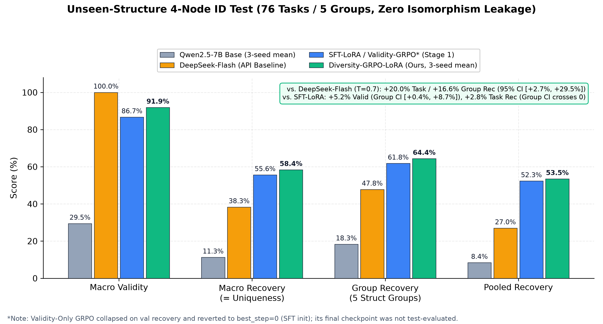
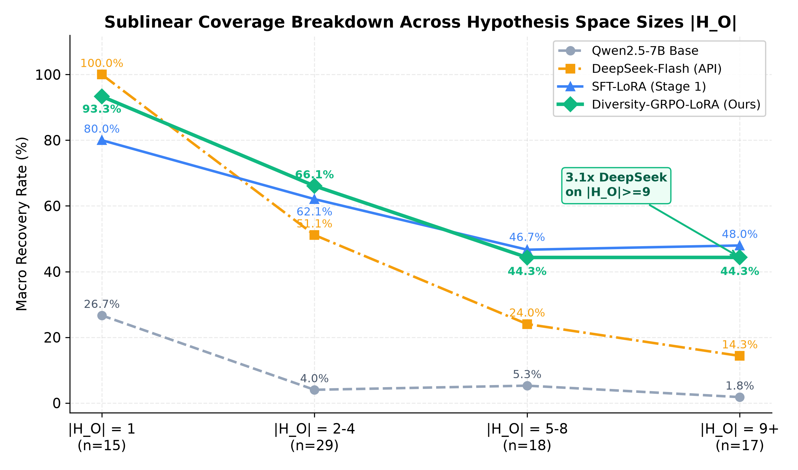
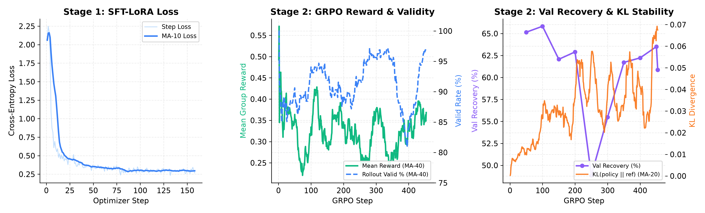
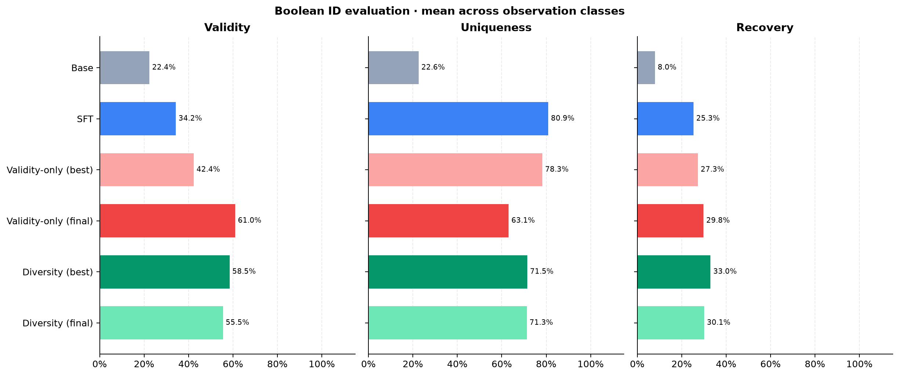
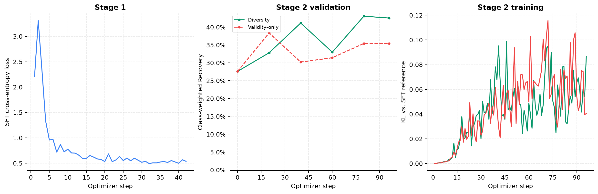
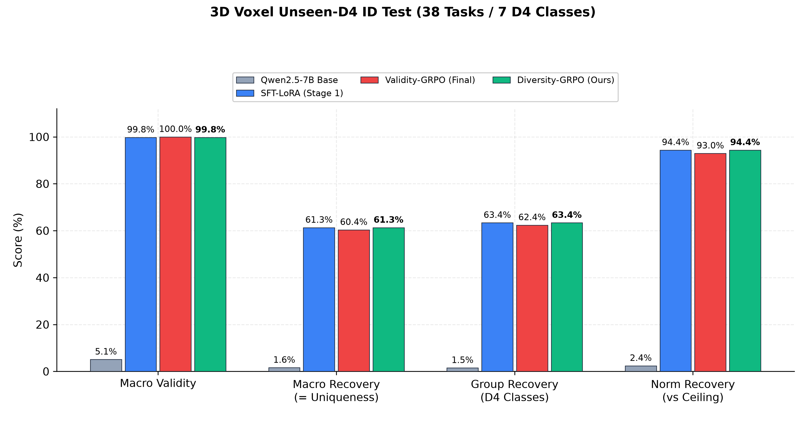
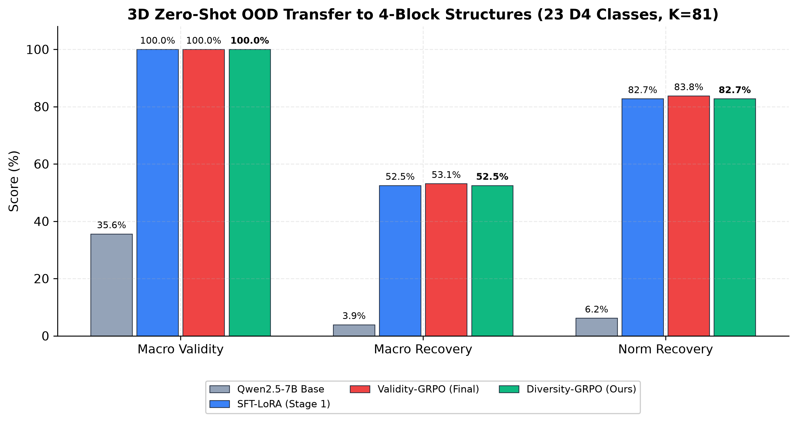

# EEC 4300 课程大作业 — HypoSpace 集合值假设采样的验证器引导两阶段微调：什么有效，什么无效

> **语言**: [English](README.md) | **简体中文**

本仓库为 **EEC 4300** 课程大作业项目，基于 **HypoSpace**（*ICML 2026*, [PMLR Vol. 306](https://proceedings.mlr.press/v306/chen26bz.html)）基准。该基准将大语言模型（LLM）视为**欠定科学假设空间**上的采样器，核心评估三大指标：**Validity（合法率）**、**Uniqueness（去重率）** 与 **Recovery（覆盖率）**。

### 核心工作与交付成果
- **三领域零同构泄露评测体系（`Causal` / `Boolean` / `3D`）**：基于等价类对称性（$S_4$ 节点置换、$x\text{-}y$ 变量对称与 $D_4$ 二面体对称）整组切分训练/验证/测试集，经 `29` 项单元测试验证零同构重叠。
- **单卡 5090 两阶段微调流水线（`Qwen2.5-7B-Instruct`）**：设计跨轮次均衡 `SFT-LoRA` + `Diversity-GRPO-LoRA`（单基座双适配器无偏 KL、Zero-Dropout、统一 `T = 0.9, top_p = 0.95` 及 `Step-0` 验证保底选优），完整落地于单张 32 GB RTX 5090。
- **跨三领域受控消融与 OOD 评测**：在 Causal（4 节点 ID + 5 节点 OOD）、Boolean（扩展 ID + Full-NOR OOD）和 3D 体素重建（1–3 块 ID + 4 块 OOD）上完成 `Base` / `SFT` / `Validity-Only GRPO` / `Diversity-GRPO` 四组对照实验。
- **统计归因分解与可视化**：实现 i.i.d. 精确期望上界归一化、`Recovery = Valid × (unique_valid / valid)` 逐题分解、10,000 次同构组聚类自助法 95% 置信区间、精确二项符号检验及三领域 12 张 300 DPI 核心图表。

> **主指标声明与统计降级口径**：本文以 **Task Macro Recovery** 与 **Structure-Group Recovery** 作为预先指定的主要指标，其余指标（`Valid`、`Uniqueness`、`Norm Rec`、`Pooled Rec`）作为辅助诊断，未对多指标/多模型做多重比较校正。当同构结构组数量较少（`n <= 7`，如 Causal ID `5` 组、3D ID `7` 组）时，聚类自助法会低估方差且二项符号检验功效极低，因此相关组级对比仅作**方向性/描述性**汇报；“统计显著”严格保留给**精确双侧二项符号检验（$p < 0.05$）与 95% 聚类置信区间同时支持**的情形。

---

## 1. 问题背景与核心结论（按证据强度分层）

在 HypoSpace 官方 **Fixed-Prompt** 独立采样协议（`--independent-samples`，每题预算 $N = |H_O|$ 且不向提示词回填历史输出）下，强闭源模型也会出现明显的**模式崩塌（Mode Collapse）**：在 4 节点未见结构测试集上，已录得的 `DeepSeek-Flash`（`T = 0.7`）合法率高达 **100.00%**，但 **Macro Recovery 跌至 38.34%**（$|H_O| \ge 9$ 难题上为 **18.52%**）。虽然在小预算下把历史输出塞进 Prompt 也能防重复，但提示词长度随查询线性增长、总 token 成本呈二次方增长（$O(N^2)$）且必须串行；将采样分布内化进模型权重后，推理成本保持线性（$O(N)$）且可完全并行。

我们在 `Qwen2.5-7B-Instruct`（统一 `T = 0.9, top_p = 0.95`）与**零同构泄露切分**（$S_4$ / $D_4$ / $x\text{-}y$ 对称规范化）下，在 **Causal**、**Boolean** 和 **3D** 三个领域评估了 **SFT-LoRA + Diversity-GRPO-LoRA** 两阶段方案。按证据强弱分层，实测结论如下：

1. **（强证据）在穷举真值（GT）上做均衡 SFT-LoRA 可大幅缓解 7B 模型的模式崩塌**：在零同构泄露设定下，Stage 1 SFT 贡献了相对零样本 `Base 7B` 的主要覆盖率提升，并将 Causal ID 上的有效样本去重率（`unique_valid / valid`）从 `DeepSeek-Flash`（`T = 0.7`）的 `38.34%` 抬升至 `67.74%`。需注意与 `DeepSeek-Flash` 的对比存在温度差异（`0.7` vs `0.9`）且微调组使用了求解器枚举 GT，仅作参考。
2. **（中等/混合证据）Stage 2 Diversity-GRPO 主要稳定提升合法率，额外覆盖率增益较小且统计上不够稳健**：在 SFT 尚未饱和的领域，Stage 2 显著提高了合法率（Causal ID `+5.20%`、Boolean ID `+23.27%`、Boolean OOD `+14.50%`）。但从 Causal ID 逐题分解来看，Stage 2 相对 SFT 的 `+2.75%` Recovery 增益**几乎全部来自合法率提升**（`86.71% → 91.91%`），有效样本去重率反略有下降（`67.74% → 65.37%`）。Stage 2 在 Recovery 上的额外收益：Causal ID 不显著（$p=0.625$）；Causal OOD 仅在单次训练+单种子上显著且对单题组敏感；Boolean ID 的 95% CI 不跨 `0` 但符号检验 $p=0.5488$，OOD 仅 `+0.55%` 不显著。
3. **（边界/负结果）3D 上接近理论上限无增益，Boolean 上对 Uniqueness 与消融带来反例**：当 SFT 已接近 i.i.d. 均匀采样上限时（3D ID 组归一化恢复率达 `96.91%`），Stage 2 增益为零（`best_step = 0`）。在 Boolean 上，`Validity-Only GRPO` 同样提升了 ID Recovery（`22.90% → 27.89%`），`Diversity-GRPO` 相对 `Validity-Only` 的 Recovery 差异不显著，且相对 SFT **显著降低了整体 `Uniqueness`**（ID `-8.94%`，OOD `-20.22%`）。

---

## 2. 实验结果（零同构泄露全量评测）

### 2.1 零同构泄露切分与 i.i.d. 精确期望上界

`n4_obs3_all.json` 的 392 题经节点全排列群 $S_4$ 规范签名（[data_utils.py](HypoSpace-release/causal/grpo_lora/data_utils.py) 中的 `canonical_isomorphism_key`）归并后，共包含 **22 个因果观测同构类**。我们以**同构类为最小单位**整组切分为：
- **Train**：13 组（`256` 题 4 节点 + `19` 题 3 节点 = `275` 题）
- **Val**：4 组（`60` 题；验证时按每组 12 题抽样 `48` 题）
- **Unseen-Structure ID Test**：5 组（`76` 题，共 `400` 次独立查询）

在 Fixed-Prompt i.i.d. 采样预算 $K = |H_O|$ 下，期望 Recovery 为 $\sum_{h \in H_O} [1 - (1 - p_h)^K]$。由函数 $1 - (1 - p)^K$ 的凹性可知，**在 $H_O$ 上均匀采样（$p_h = 1/K$）即为该协议下期望 Recovery 的精确最大值**（exact maximum）：$1 - (1 - 1/K)^K$（ID 测试集均值 `70.38%`；5 节点 OOD 为 `81.41%`）。个别结构组归一化后超过 `100%`（如 OOD `G15` 为 `133.33%`），正反映了单题/单种子的**有限采样随机波动**，并非超过理论上限。统计通过 [group_stats.py](results_analysis/group_stats.py) 计算。

### 2.2 Causal 4 节点未见结构 ID 测试集（76 题 / 5 结构组）

每个 Qwen 模型**只训练 1 次**，评测采用与官方 `create_prompt(..., prior_hypotheses=[])` 文本一致的 `build_fixed_prompt()` 并套用标准对话模板，结果取 **3 个评测采样种子**（`33550336, 1, 2`，`T = 0.9, top_p = 0.95`）均值。`DeepSeek-Flash` 取自 392 题全量 Fixed-Prompt 运行结果（`T = 0.7`，[config_deepseek.yaml](HypoSpace-release/causal/config/config_deepseek.yaml)）按同一批 76 题截取。

| 模型 / 方法 | 评测口径 | Parse | Valid | **Task Macro Rec (= Uniq)** | Task Norm Rec | **Group Rec (mean ± std)** | Group Norm Rec | Pooled Rec |
|---|---|---:|---:|---:|---:|---:|---:|---:|
| `Qwen2.5-7B Base` | Zero-shot, 3 评测种子, `T=0.9` | 100.00% | 29.47% | 11.29% | 14.97% | 18.34% ± 22.45% | 21.26% ± 20.89% | 8.42% |
| `DeepSeek-Flash` *（仅供参考）* | API, 1 次运行, **`T=0.7`** *（温度非同口径）* | **100.00%** | **100.00%** | 38.34% | 52.47% | 47.80% ± 33.61% | 59.40% ± 31.47% | 27.00% |
| `SFT-LoRA`（`= Validity-GRPO best`）* | 3 评测种子, `T=0.9` | 97.69% | 86.71% | 55.63% | 78.70% | 61.81% ± 17.15% | 81.26% ± 6.98% | 52.33% |
| **`Diversity-GRPO-LoRA`** | 3 评测种子, `T=0.9` | 98.42% | **91.91%** | **58.38%** | **82.50%** | **64.37% ± 16.88%** | **84.78% ± 8.10%** | **53.50%** |

*\*注：（1）Causal 与 3D 中每题预算 $N = |H_O|$ 且真值穷举，故 `Uniqueness == Recovery`。（2）`Validity-Only GRPO` 触发 `best_step == 0` 退回 SFT 初始化权重（验证集 4 组上 `Valid 77.52% → 96.27%` 而 `Group Rec 55.82% → 52.17%`，仅作验证集坍缩定性观察，末步权重未在测试集评测），故测试集中 `diversity - validity` 与 `diversity - sft` 为同一组对比，不再重复计数。*

- **逐题 `Recovery = Valid × (unique_valid / valid)` 分解分析（Causal ID）**：

| 模型 | Valid Rate | **Task Macro Recovery** | 有效样本去重率均值 (`unique_valid / valid`) | Group 有效去重率 |
|---|---:|---:|---:|---:|
| `DeepSeek-Flash` (`T=0.7`) | **100.00%** | 38.34% | 38.34% (`n=76`) | 47.80% |
| `SFT-LoRA` (`T=0.9`) | 86.71% | 55.63% | **67.74%** (`n=76`) | **73.74%** |
| `Diversity-GRPO-LoRA` (`T=0.9`) | 91.91% | **58.38%** | 65.37% (`n=76`) | 72.02% |

  *核心诊断*：在 Causal ID 上，**真正大幅缓解 mode collapse（`38.34% → 67.74%`）的是 Stage 1 SFT**；Stage 2 相对 SFT 的 `+2.75%` 增益**全部由合法率提升（`86.71% → 91.91%`）贡献**，有效样本内部去重率反而略有回落（`67.74% → 65.37%`）。

- **统计检验（[id_v2_stats.md](results_analysis/id_v2_stats.md)，仅 `n = 5` 个同构组，作描述性解读）**：
  - **`Diversity-GRPO` vs `SFT-LoRA`**：Task Rec **`+2.75%`**，Group Rec **`+2.56%`**（`3 胜 / 1 平 / 1 负`，精确符号检验 **$p = 0.6250$**，95% CI **`[-0.31%, +5.43%]`** 跨 `0` —— **统计上不显著**，仅 3 个评测种子方向一致：`57.75% vs 54.20%`、`58.13% vs 54.33%`、`59.27% vs 58.35%`）；仅 Validity 上升（Task `+5.20%`、Group `+4.46%`，CI `[+0.42%, +8.73%]`，符号检验 $p = 0.1250$）。
  - **`Diversity-GRPO` vs `DeepSeek-Flash` *（非同口径参考）***：Task Rec **`+20.04%`**（57/11/8），Group Rec **`+16.57%`**（`4/0/1`，精确符号检验 **$p = 0.3750$**，CI `[+2.71%, +29.52%]`；其中 `sft - deepseek` 的 Group CI **`[-0.19%, +28.19%]`** 跨 `0`），同时存在 **Validity 劣势（`-8.09%`，`5/5` 组均输）**。一边是在同族任务上用求解器穷举 GT 微调的小模型、另一边是零样本 API 且采样温度不同（`0.7` vs `0.9`），这说明的是任务特定训练有效，而非方法优于闭源大模型。

#### 按假设空间难度 `|H_O|` 分桶对比（Macro Recovery）

| 难度分桶 (`\|H_O\|`) | 题数（组数） | 精确期望上界 | `Base 7B` | `DeepSeek-Flash` (`T=0.7`) | `SFT-LoRA` | `Diversity-GRPO` | 归一化恢复率 |
|---|---:|---:|---:|---:|---:|---:|---:|
| `1`（唯一解） | 4 (1) | 100.00% | 58.33% | **100.00%** | 91.67% | 91.67% | 91.67% |
| `2–4` | 36 (2) | 71.91% | 10.03% | 51.85% | 57.10% | **63.43%** | **88.22%** |
| `5–8` | 24 (1) | 65.64% | 8.51% | 17.71% | **47.92%** | 46.53% | 70.88% |
| `9+` | 12 (1) | 65.36% | 4.94% | 18.52% | 54.63% | **55.86%** | **85.48%** |

<p align="center">
  
  
</p>

### 2.3 Causal 跨规模 5 节点 OOD 迁移测试（80 题 / 22 结构组）

在从未见过的 5 节点因果系统上使用**单评测种子（`33550336`，`T = 0.9, top_p = 0.95`）**零样本迁移评测 [n5_obs5_hybrid80.json](HypoSpace-release/causal/datasets/n5_obs5_hybrid80.json)（80 题，22 组，上界 `81.41%`）与 [causal_n5_gt160.json](HypoSpace-release/causal/benchmark_obs_count/paper_scale/causal_n5_gt160.json)（7 题，$|H_O|=160$）：

| 数据集 | 模型 | Valid | **Task Macro Rec** | **Group Rec (mean ± std)** | Group Norm Rec | Pooled Rec | `Bucket 9+` Rec |
|---|---|---:|---:|---:|---:|---:|---:|
| `n5_obs5_hybrid80` (`80` 题) | `Qwen2.5-7B Base` | 28.14% | 26.58% | 17.78% ± 33.72% | 18.71% ± 33.90% | 1.69% | 0.07% |
| `n5_obs5_hybrid80` (`80` 题) | `SFT-LoRA` (`= Validity*`) | 67.54% | 56.97% | 50.92% ± 28.47% | 61.69% ± 26.17% | 28.28% | 26.43% |
| `n5_obs5_hybrid80` (`80` 题) | **`Diversity-GRPO-LoRA`** | **70.33%** | **61.70%** | **63.21% ± 26.63%** | **78.17% ± 24.67%** | **31.38%** | **29.28%** |
| `causal_n5_gt160` (`7` 题) | `Diversity-GRPO-LoRA` *(无基线参考)* | 19.29% | 10.71% | — | — | 10.71% | 10.71% |

- **22 组 OOD 统计结论与敏感性复核（[ood_n5_v2_stats.md](results_analysis/ood_n5_v2_stats.md)）**：
  - `Diversity-GRPO` vs `SFT-LoRA`：Task Macro Rec **`+4.73%`**、Pooled Rec **`+3.10%`**、结构组均值 **`+12.29% ± 24.88%`**（`12 胜 / 8 平 / 2 负`，精确符号检验 **$p = 0.0129$**，95% CI **`[+3.50%, +23.68%]`**），`Task Dedup` 从 `82.95%`（`n=74`）升至 `85.03%`（`n=75`）。但这一单次训练+单种子证据存在 **三项重要保留条件**：
    1. **对单题结构组高度敏感**：22 组中有 `10` 组仅含 `1` 题（`n_tasks == 1` 贡献 `+19.38% ± 32.60%`，`5/5/0`，如单题 `G15` `0% → 100%` 归一化 `133.33%`、噪声较大）。若仅看多题结构组（`n_tasks >= 2`，`12` 组），`Diversity - SFT` 组差值降为 **`+6.39% ± 15.10%`**（`7/3/2`，符号检验 **$p = 0.1797$**，95% CI **`[-1.67%, +14.79%]`** 跨 `0`）；最大多解组 `G22`（19 题，`9+`）仅提升 `+2.46%`（`9+` 桶归一化仅 `45.99%`）。
    2. **单解组反例**：最大单解组 `G02`（13 题）上 Ours `76.92%` 低于 SFT `92.31%`（被其他单解组抵消后 `|H_O|=1` 桶均值持平于 `85.29%`）。
    3. **训练运行间方差参考**：在同一 5 节点 OOD 数据集上，早期 v1.0 的 `SFT = 60.90%`（Pooled `33.36%`）、`GRPO = 61.64%`（Pooled `29.13%`），而 v2.1 为 `SFT = 56.97%`（Pooled `28.28%`）、`Diversity = 61.70%`（Pooled `31.38%`）。尽管两版 4 节点训练集与配方不同，也说明单次运行约 `±4pp` 的波动与 v2.1 的 `+4.73%` 增幅处于同一量级。

<p align="center">
  
  
</p>

---

### 2.4 跨领域扩展评测：Boolean 基因交互与 3D 体素重建

#### 2.4.1 Boolean 基因交互建模（[id_boolean_stats.md](results_analysis/id_boolean_stats.md)、[ood_boolean_stats.md](results_analysis/ood_boolean_stats.md)）

- **零同构泄露切分（`x/y` 对称）**：`train`（66 题 / 30 组）、`val`（14 题 / 8 组）、**ID 测试集**（19 题 / 13 组，3 种子均值，上界 `69.03%`）及 **Full-NOR OOD**（[boolean_full_d2.json](HypoSpace-release/causal/benchmark_obs_count/paper_scale/boolean_full_d2.json)，80 题 / 53 组，含未见 `NOR` 算子，单种子，上界 `66.76%`）。
- **指标与配对说明**：Boolean 官方评测中的 `Uniqueness` **统计了所有语法在空间内的不重复公式（包括不满足观测的非法公式）**，因此数值远高于 `Recovery`（例如 SFT ID `Uniq 82.44%` vs `Rec 22.90%`）；为此我们补充了 `Valid Dedup = unique_valid / valid`。此外，默认 OOD 流水线对比了 `Diversity best` 与 `Validity final`，下文在 ID 上补齐了 `best vs best` 与 `final vs final` 对称比较。

| 评测集 | 模型 / 方法 | Valid | Uniq *(含非法)* | 有效样本去重率 (`n` 题有合法解) | **Task Macro Rec** | Task Norm Rec | **Group Rec (mean ± std)** |
|---|---|---:|---:|---:|---:|---:|---:|
| ID (`19` 题, `3` 种子) | `Qwen2.5-7B Base` | 20.70% | 24.22% | 62.18% (`9`) | 7.64% | 11.38% | 7.97% ± 10.03% |
| ID (`19` 题, `3` 种子) | `SFT-LoRA` | 30.89% | **82.44%** | **79.62%** (`14`) | 22.90% | 34.52% | 25.31% ± 19.04% |
| ID (`19` 题, `3` 种子) | `Validity-Only (best / step 20)` | 38.94% | 79.42% | 74.80% (`15`) | 24.36% | 36.70% | 27.32% ± 18.58% |
| ID (`19` 题, `3` 种子) | `Validity-Only (final)` | **59.12%** | 62.77% | 56.40% (`17`) | 27.89% | 41.10% | 29.83% ± 14.21% |
| ID (`19` 题, `3` 种子) | **`Diversity-GRPO (best / step 80)`** | 54.16% | 73.50% | 68.51% (`18`) | **31.16%** | **46.23%** | **32.98% ± 14.99%** |
| ID (`19` 题, `3` 种子) | `Diversity-GRPO (final / step 96)` | 48.78% | 73.00% | 65.30% (`15`) | 26.37% | 39.75% | 30.11% ± 19.91% |
| OOD (`80` 题, `1` 种子) | `Qwen2.5-7B Base` | 19.01% | 9.56% | 14.31% (`18`) | 1.80% | 2.76% | 2.09% ± 4.46% |
| OOD (`80` 题, `1` 种子) | `SFT-LoRA` | 28.86% | **58.01%** | **67.36%** (`59`) | 17.11% | 26.22% | 16.72% ± 11.75% |
| OOD (`80` 题, `1` 种子) | `Validity-Only (final)` | **50.21%** | 32.29% | 42.55% (`68`) | 16.19% | 24.66% | 16.21% ± 9.57% |
| OOD (`80` 题, `1` 种子) | `Diversity-GRPO (best)` | 43.36% | 37.79% | 52.10% (`70`) | **17.66%** | **26.86%** | **17.86% ± 9.19%** |

- **完整无偏倚的 Boolean 对比发现**：
  - **vs `SFT-LoRA`**：`Diversity-GRPO (best)` 在 ID（**`+23.27%`**, $p = 0.0005$）和 OOD（**`+14.50%`**, $p < 10^{-4}$）上均显著提升 **Valid**。但在 **Recovery** 上，ID 为 `+8.26%` Task / `+7.66%` Group（CI `[+1.65%, +13.74%]` 不跨 `0`，但符号检验 **$p = 0.5488$**），**OOD 几乎无差异（`+0.55%` Task / `+1.13%` Group，$p = 0.7359$，CI `[-1.57%, +3.97%]` 不显著）**；同时 `Diversity-GRPO` 相对 SFT **显著降低了整体 `Uniqueness`**（ID **`-8.94%`**, CI `[-17.00%, -1.71%]`；OOD **`-20.22%`**, $p < 10^{-4}$, CI `[-25.55%, -12.55%]`）。
  - **vs `Validity-Only`（非对称与对称对比）**：`Validity-Only` 在 Boolean ID 上**同样提升了 Recovery**（`22.90% → 27.89%`），不支持“纯合法性奖励必然拉低覆盖率”的通用说法。无论是 `diversity best - validity_final`（ID CI `[-1.59%, +7.96%]`；OOD CI `[-0.75%, +4.06%]`），还是对称对比 **`best vs best`**（Recovery Task `+6.81%` / Group `+5.66%`, $p = 0.0654$, CI `[-0.03%, +10.99%]`; Valid `+15.22%`, $p = 0.0010$）与 **`final vs final`**（Recovery Task `-1.52%` / Group `+0.27%`, $p = 0.7539$, CI `[-6.23%, +6.36%]`，其中 `diversity_final` `26.37%` 低于 `validity_final` `27.89%`），Recovery 差异均**不显著**。唯一稳健占优的是 OOD 上 `Diversity best` 相比 `Validity final` 的 `Uniqueness`（`+5.50%` Task / `+6.32%` Group，$p = 0.0022$, CI `[+2.14%, +10.75%]`）。

<p align="center">
  
  
</p>

#### 2.4.2 3D 重力约束体素重建（[id_3d_stats.md](results_analysis/id_3d_stats.md)、[ood_3d_b4_stats.md](results_analysis/ood_3d_b4_stats.md)）

- **零同构泄露切分（$D_4$ 对称群）**：27 个 1–3 块结构类分为 `train`（16 类 / 73 题）、`val`（4 类 / 16 题）、**ID 测试集**（38 题 / 7 组，3 种子均值，上界 `64.81%`）与 **4-Block OOD**（[3d_g3_h3_b4_ood.json](HypoSpace-release/3d/datasets/3d_g3_h3_b4_ood.json)，23 题 / 23 组，单种子，上界 `63.44%`）。

| 评测集 | 模型 / 方法 | Valid | **Task Macro Rec** | Task Norm Rec | **Group Rec (mean ± std)** | Group Norm Rec |
|---|---|---:|---:|---:|---:|---:|
| ID (`38` 题, `3` 种子) | `Qwen2.5-7B Base` | 5.10% | 1.59% | 2.41% | 1.50% ± 1.99% | 2.23% ± 2.84% |
| ID (`38` 题, `3` 种子) | `SFT-LoRA`（`= Diversity best`, `best_step=0`） | 99.77% | 61.31% | 94.39% | **63.38% ± 7.95%** | **96.91% ± 8.78%** |
| ID (`38` 题, `3` 种子) | `Validity-Only (best / step 90)` | **100.00%** | 61.08% | 94.03% | 63.12% ± 8.17% | 96.50% ± 9.14% |
| ID (`38` 题, `3` 种子) | `Validity-Only (final)` | **100.00%** | 60.36% | 92.96% | 62.39% ± 7.43% | 95.42% ± 8.26% |
| ID (`38` 题, `3` 种子) | `Diversity-GRPO (final / step 95)` | **100.00%** | **61.70%** | **95.23%** | 61.82% ± 1.70% | 94.80% ± 2.62% |
| OOD (`23` 题, `1` 种子) | `Qwen2.5-7B Base` | 35.59% | 3.92% | 6.18% | 3.92% ± 2.16% | 6.18% ± 3.40% |
| OOD (`23` 题, `1` 种子) | `SFT-LoRA`（`= Diversity best`） | **100.00%** | 52.50% | 82.75% | 52.50% ± 2.63% | 82.75% ± 4.14% |
| OOD (`23` 题, `1` 种子) | `Validity-Only (final)` | **100.00%** | **53.14%** | **83.76%** | **53.14% ± 4.51%** | **83.76% ± 7.10%** |

- **负结果与饱和边界**：在 3D 任务上，Stage 1 SFT 已直接收敛至 `Valid = 99.77%`、**Group Norm Recovery = `96.91%`**（4-Block OOD 达上界的 `82.75%`），几乎贴近 i.i.d. 均匀采样期望最大值（`max KL = 0.0068`）。`Diversity-GRPO` 验证选优触发 `best_step = 0`（回退 SFT，**Stage 2 贡献为零**）；ID 上 `+0.94%`（Group `+0.99%`）的差异本质上是 **`SFT vs Validity-final`**（且仅 `n = 7` 组，只作描述性对照），与 Diversity 方法无关；`diversity_final` 的 Group Rec（`61.82%`）略低于 SFT（`63.38%`），OOD 上 `Validity-final`（`53.14%`）也略高于 SFT（`52.50%`，不显著）。

<p align="center">
  
  
</p>

#### 2.4.3 三领域综合结论

Stage 1 均衡 SFT 是三个领域中 Recovery 提升的主要来源。Stage 2 的主要可测效果是提高合法率；它对覆盖率的额外贡献依赖于 SFT 离 i.i.d. 精确期望上界的距离：3D 上为零，Causal 和 Boolean 上为小幅正向但统计上不稳健。在 Boolean 上，仅奖励合法性同样提升了 ID Recovery，与“合法性奖励必然导致坍缩”的假设不一致；多样性项相对 SFT 反而降低了整体 Uniqueness。

---

## 3. 方法设计、学术定位与讨论

1. **Stage 1 — 轮换均衡 SFT-LoRA**（[train_sft.py](HypoSpace-release/causal/grpo_lora/train_sft.py)）：零样本 7B 模型合法率极低（Causal ID `29.47%`、Boolean ID `20.70%`、3D ID `5.10%`），直接跑 RL 易陷入全错梯度消失。Stage 1 采用 Prompt Loss Masking、边/操作数顺序打乱与每题固定预算（$\min(K, 8)$）的轮换抽样。**理论补充**：在穷举 GT $H_O$ 上做等权 MLE，本身即隐式拟合 $H_O$ 上的均匀分布；而在 Fixed-Prompt i.i.d. 协议下，均匀分布恰好是期望 Recovery 的理论最优解，因此 SFT 已经指向最优采样分布。
2. **Stage 2 — 排列不变层级 Diversity-GRPO-LoRA**（[train_grpo.py](HypoSpace-release/causal/grpo_lora/train_grpo.py)、[verifier_reward.py](HypoSpace-release/causal/grpo_lora/verifier_reward.py)）：在统一采样配置（`T=0.9, top_p=0.95`）下采样 $G=8$ 个候选，采用严格层级且顺序无关的逆频次奖励：
   $$r_i = \begin{cases}
   -1.0, & \text{无法解析 / 结构不合法} \\
   -0.7 + 0.3 \times \text{ObsMatchRatio}(g_i, O), & \text{结构合法但违反观测约束 } \in [-0.7, -0.4] \\
   0.1 + \frac{0.9 + 0.5 \cdot \bar{d}_{\text{Jaccard}}(g_i, \mathcal{U}\setminus\{g_i\})}{\text{count}(g_i)}, & \text{满足全部观测的合法假设 } (\ge +0.1)
   \end{cases}$$
   结合上面的理论与实测（Causal 上 `max step KL = 0.020`，`best` 仅高出 `final` `0.18pp`），Stage 2 的实际作用更准确地定位为**对 SFT 的小幅后修正**——重点把概率质量从非法输出挪向合法输出，并在泛化场景中纠正部分残余偏置。
3. **相关工作定位与 $G < K$ 尺度失配**：组内逆频次结合相似度距离的集合奖励与近年多篇 diversity-aware GRPO / 集合级 RL 工作（如联合优化质量与多样性的 *DARLING* 等思路）相近；本文不宣称奖励函数形式本身全新，贡献在于将精确验证器、严格层级奖励与跨三领域的零同构泄露分组评测整合到 HypoSpace 中。此外，训练每组 rollout 大小 $G = 8$ 在难题（`9+` 桶，$|H_O| \gg 8$）上远小于评测预算 $K = |H_O|$，这可能是 Stage 2 在超大假设空间上增益受限的结构原因之一。

---

## 4. Limitations（局限性说明）

- **依赖求解器产出的穷举真值（GT）**：Stage 1 SFT 与 Stage 2 过滤均依赖训练集中已枚举的全部合理假设集合；在真实科学发现场景中，这类穷举 GT 往往并不可得。
- **同构组数量少导致检验功效偏低**：严格去泄露后，Causal ID 仅剩 `5` 组（76 题）、3D ID 仅 `7` 组（38 题）、Boolean ID 仅 `13` 组（19 题）；簇数 $\le 7$ 时聚类自助法会低估方差且二项检验功效有限。
- **单次训练、跨版本方差与单种子 OOD**：微调模型均只训练 1 次。以完全相同的 5 节点 OOD 数据集为参照，v1.0 的 `SFT = 60.90%` / `GRPO = 61.64%` 与 v2.1 的 `SFT = 56.97%` / `Diversity = 61.70%` 之间存在约 `±4pp` 的跨运行波动，和 v2.1 的 `+4.73%` Task 差值处于同一量级；且 Causal OOD 的组级显著性高度依赖单题组。
- **Boolean 选点不对称与 Uniqueness 下降**：默认 OOD 脚本对比了 `Diversity best` 与 `Validity final`；而在 ID 对称比较（`best vs best`、`final vs final`）中两者 Recovery 差异均不显著，且多样性奖励相对 SFT 降低了整体 `Uniqueness`。
- **`DeepSeek-Flash` 温度混杂与两域 API 覆盖范围**：`DeepSeek-Flash` 为 `T = 0.7`（与 Qwen `T = 0.9` 不同口径，温度直接影响多样性与覆盖率），且 3D 与 Boolean 零泄露测试集上的闭源 API Fixed-Prompt 基线留作后续扩展（第 2.4 节聚焦开源四组消融对比）。
- **`causal_n5_gt160` 缺少基线对照**：该 7 题子集仅运行了 `Diversity-GRPO-LoRA`，仅作超大空间参考。

---

## 5. 仓库结构与快速复现

```text
.
├── README.md / README_ZH.md                   # 中英文双语全局说明（覆盖三领域结果）
├── results_analysis/
│   ├── group_stats.py / generate_charts.py    # Causal v2.1 统计与图表 -> figures/
│   ├── stats_3d.py / generate_charts_3d.py    # 3D D4 群统计与图表 -> figures_3d/
│   ├── stats_boolean.py / generate_charts_boolean.py  # Boolean 等价类统计与图表 -> figures_boolean/
│   ├── id_v2_stats.md / ood_n5_v2_stats.md    # Causal v2.1 统计报告 (.md / .json)
│   ├── id_3d_stats.md / ood_3d_b4_stats.md    # 3D 统计报告 (.md / .json)
│   ├── id_boolean_stats.md / ood_boolean_stats.md  # Boolean 统计报告 (.md / .json)
│   └── figures{,_3d,_boolean}/               # 三领域各 4 张 300 DPI 核心图表
├── qwen7b_v2_results_and_logs/                # Causal v2.1 零同构泄露全套 5090 评测 JSON 与训练日志
├── qwen7b_results_and_logs/                   # Causal v1.0 历史基线留档
├── qwen7b_3d_results_and_logs/                # 3D RTX 5090 评测 JSON 与训练日志
├── qwen7b_boolean_results_and_logs/           # Boolean RTX 5090 评测 JSON 与训练日志
└── HypoSpace-release/
    ├── causal/grpo_lora/                      # Causal SFT + GRPO-LoRA 源码与 10 阶段流水线
    ├── 3d/grpo_lora/                          # 3D 体素重建流水线与 10 阶段服务器脚本
    └── boolean/grpo_lora/                     # Boolean 基因交互流水线与服务器脚本
```

```bash
# 1. 三个领域的单元测试与零同构泄露切分校验（CPU 即可运行）
python HypoSpace-release/causal/grpo_lora/tests/test_verifier_reward.py
python HypoSpace-release/causal/grpo_lora/data_utils.py
python -m unittest discover -s HypoSpace-release/3d/grpo_lora/tests -v
python HypoSpace-release/3d/grpo_lora/data_utils.py
python -m unittest discover -s HypoSpace-release/boolean/grpo_lora/tests -v
python HypoSpace-release/boolean/grpo_lora/data_utils.py

# 2. 重新生成 Causal v2.1 ID 与 OOD 结构组统计报告，以及全套 4 张图表
python results_analysis/group_stats.py --model diversity=qwen7b_v2_results_and_logs/causal/grpo_lora/results/qwen7b_v2_unseen_grpo_diversity_seed*.json --model validity=qwen7b_v2_results_and_logs/causal/grpo_lora/results/qwen7b_v2_unseen_grpo_validity_seed*.json --model sft=qwen7b_v2_results_and_logs/causal/grpo_lora/results/qwen7b_v2_unseen_sft_seed*.json --model base=qwen7b_v2_results_and_logs/causal/grpo_lora/results/qwen7b_v2_unseen_base_seed*.json --deepseek_baseline HypoSpace-release/causal/benchmark_obs_count/full_repo_causal_n4_obs3_deepseek.json --splits_path HypoSpace-release/causal/grpo_lora/splits/causal_splits.json --pairs diversity:sft --pairs diversity:validity --pairs diversity:deepseek --pairs sft:deepseek --pairs diversity:base --pairs sft:base --output_md results_analysis/id_v2_stats.md --output_json results_analysis/id_v2_stats.json

python results_analysis/group_stats.py --model diversity=qwen7b_v2_results_and_logs/causal/grpo_lora/results/qwen7b_v2_ood_n5_grpo_diversity_seed33550336.json --model validity=qwen7b_v2_results_and_logs/causal/grpo_lora/results/qwen7b_v2_ood_n5_grpo_validity_seed33550336.json --model sft=qwen7b_v2_results_and_logs/causal/grpo_lora/results/qwen7b_v2_ood_n5_sft_seed33550336.json --model base=qwen7b_v2_results_and_logs/causal/grpo_lora/results/qwen7b_v2_ood_n5_base_seed33550336.json --dataset_path HypoSpace-release/causal/datasets/n5_obs5_hybrid80.json --pairs diversity:sft --pairs diversity:validity --pairs diversity:base --pairs sft:base --output_md results_analysis/ood_n5_v2_stats.md --output_json results_analysis/ood_n5_v2_stats.json

python results_analysis/generate_charts.py

# 3. RTX 5090 全量训练与多种子评测流水线（位于 HypoSpace-release/，单卡请串行运行）
bash causal/grpo_lora/run_server_all.sh
bash 3d/grpo_lora/run_server_all.sh
bash boolean/grpo_lora/run_server_all.sh
```
完整服务器部署命令请参阅 [causal/grpo_lora/RUN_GUIDE.md](HypoSpace-release/causal/grpo_lora/RUN_GUIDE.md)、[3d/grpo_lora/RUN_GUIDE.md](HypoSpace-release/3d/grpo_lora/RUN_GUIDE.md) 与 [boolean/grpo_lora/RUN_GUIDE.md](HypoSpace-release/boolean/grpo_lora/RUN_GUIDE.md)。
