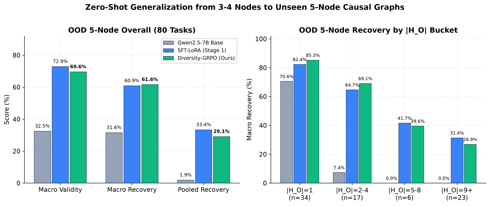

# EEC 4300 课程大作业 — 基于两阶段 Diversity-Aware GRPO-LoRA 突破 HypoSpace 欠定假设覆盖瓶颈

> **语言**: [English](README.md) | **简体中文**

本仓库为 **EEC 4300** 课程大作业项目，基于 **HypoSpace**（*ICML 2026*, [PMLR Vol. 306](https://proceedings.mlr.press/v306/chen26bz.html)）基准。该基准将大语言模型（LLM）视为**欠定科学假设空间**上的采样器，核心评估三大指标：**Validity（有效性）**、**Uniqueness（去重率）** 与 **Recovery（覆盖率）**。

---

## 1. 核心问题与动机

在 HypoSpace 官方 **Fixed-Prompt** 独立采样协议（`--independent-samples`，每题预算 $N = |H_O|$，且不将历史输出塞进提示词）下，即使是强闭源大模型也会遭遇严重的**模式崩塌（Mode Collapse）与次线性覆盖瓶颈**：
- 在 4 节点因果图推断数据集（[n4_obs3_all.json](HypoSpace-release/causal/datasets/n4_obs3_all.json)）上，**`DeepSeek-Flash`** 的 **Validity 高达 99.74%–100%**，但 **Recovery 却跌至 ~45%–46%**，在解空间较大的难题（$|H_O| \ge 9$）上更是骤降至 **14.34%**；
- 标准监督微调（**SFT-LoRA**）虽能学会格式与基础推理，但缺少“组内样本互不重复”的集合级反馈，Validity 也仅停留在 **88.29%**。

为此，我们在开源 7B 模型（`Qwen2.5-7B-Instruct`）上提出 **Two-Stage Diversity-Aware GRPO-LoRA**——不依赖 Prompt 历史防重复技巧，也严禁验证器特征泄露，直接通过可微策略优化重塑模型内部分布，使其在保持高合法性的同时均匀探索整个可行假设空间。

---

## 2. 核心实测结果（Fixed-Prompt 协议，$N = |H_O|$）

### 2.1 同分布 Causal 测试集（79 题留出 4 节点集，共 433 次查询）

所有对比模型均在 [causal_splits.json](HypoSpace-release/causal/grpo_lora/splits/causal_splits.json) 中**完全相同的 79 个留出 `observation_set_id`** 上评测，并与已记录的 `DeepSeek-Flash` 基线（[full_repo_causal_n4_obs3_deepseek.json](HypoSpace-release/causal/benchmark_obs_count/full_repo_causal_n4_obs3_deepseek.json)）逐题配对对比：

| 模型 / 方法 | Parse | Macro Valid | Macro Uniq | **Macro Recovery** | **Pooled Recovery** | 相比 DeepSeek-Flash |
|---|---:|---:|---:|---:|---:|---:|
| `Qwen2.5-7B Base` (Zero-shot) | 99.84% | 18.35% | 8.13% | 8.13% | 3.93% | -38.19% |
| `DeepSeek-Flash` (闭源 API 基线) | **100.00%** | **100.00%** | 46.32% | 46.32% | 25.87% | Baseline |
| `Qwen2.5-7B + SFT-LoRA` (Stage 1) | 99.37% | 88.29% | 58.93% | 58.93% | **50.58%** | +12.61% |
| **`Qwen2.5-7B + Diversity-GRPO-LoRA` (本文方法)** | **100.00%** | **94.03%** | **61.62%** | **61.62%** | 49.88% | **+15.30%** |

- **79 题逐题配对统计检验**：
  - `Diversity-GRPO-LoRA` vs. `DeepSeek-Flash`：$\Delta = +15.29\%$（**39 胜 / 34 平 / 仅 6 负**），paired $t = 5.116$（$p = 2.18 \times 10^{-6}$），Wilcoxon $p = 2.25 \times 10^{-6}$。
  - `Diversity-GRPO-LoRA` vs. `Base 7B`：$\Delta = +53.49\%$（**71 胜 / 8 平 / 0 负**），$p = 6.13 \times 10^{-25}$。

#### 按假设空间难度 `|H_O|` 分桶对比（Macro Recovery）

| 难度分桶 (`\|H_O\|`) | 题数 | `Base 7B` | `DeepSeek-Flash` | `SFT-LoRA` | **`Diversity-GRPO-LoRA`** | GRPO / DeepSeek |
|---|---:|---:|---:|---:|---:|---:|
| `1`（唯一解） | 15 | 26.67% | **100.00%** | 80.00% | **93.33%** | 0.93x |
| `2–4` | 29 | 4.02% | 51.15% | 62.07% | **66.09%** *(Valid 100%)* | **1.29x** |
| `5–8` | 18 | 5.28% | 24.03% | **46.67%** | **44.31%** | **1.84x** |
| **`9+`（最难大空间）** | 17 | 1.80% | 14.34% | **47.96%** | **44.32%** | **3.09x** |

<p align="center">
  
  
</p>

### 2.2 跨节点规模 OOD 5 节点泛化测试（训练仅使用 3–4 节点图）

在训练从未见过的 5 节点因果系统（[n5_obs5_hybrid80.json](HypoSpace-release/causal/datasets/n5_obs5_hybrid80.json)，80 题，1,418 次查询；以及 [causal_n5_gt160.json](HypoSpace-release/causal/benchmark_obs_count/paper_scale/causal_n5_gt160.json)，7 题 $|H_O|=160$）上直接零样本迁移评测：

| 数据集 | 模型 | Macro Valid | Macro Uniq | **Macro Recovery** | Pooled Recovery | `Bucket 9+` Recovery |
|---|---|---:|---:|---:|---:|---:|
| `n5_obs5_hybrid80` (80 题) | `Qwen2.5-7B Base` | 32.50% | 31.56% | 31.56% | 1.90% | 0.00% |
| `n5_obs5_hybrid80` (80 题) | `Qwen2.5-7B + SFT-LoRA` | **72.89%** | 60.90% | 60.90% | **33.36%** | **31.39%** |
| `n5_obs5_hybrid80` (80 题) | **`Qwen2.5-7B + Diversity-GRPO-LoRA`** | 69.61% | **61.64%** | **61.64%** | 29.13% | 26.90% |
| `causal_n5_gt160` (7 题, `\|H_O\|=160`) | **`Qwen2.5-7B + Diversity-GRPO-LoRA`** | 32.41% | 11.96% | 11.96% | 11.96% | 11.96% |

- 在 `n5_obs5_hybrid80` 上，`Base 7B` 在 `5–8` 与 `9+` 分桶均跌至 **0.00%**，而 `Diversity-GRPO-LoRA` 将 Macro Recovery 提升了 **+30.08%**（53 胜 / 22 平 / 5 负，Wilcoxon $p = 1.44 \times 10^{-6}$）。
- **实验洞察**：Stage 2 GRPO 在同分布上带来了清晰的正向提升（`Valid`: 88.29% → 94.03%，`Macro Recovery`: 58.93% → 61.62%），而在未见过的 5 节点大空间上 Stage 1 SFT 的 Pooled Recovery 略高（33.36% vs. 29.13%），说明仅在 3–4 节点上做 RL 会产生轻微的节点规模特化。

<p align="center">
  
  
</p>

---

## 3. 方法架构

### 为什么拆分为两个阶段？
1. **Stage 1 — 去偏 SFT-LoRA Warm-up**（[train_sft.py](HypoSpace-release/causal/grpo_lora/train_sft.py)）：未微调 7B 基座的合法率仅 18.35%，直接做 RL 容易因组内全错导致“零方差梯度消失”。Stage 1 采用 Prompt Loss Masking、每题均匀抽样最多 8 个 Ground Truth 以及**边序随机打乱（`shuffle_edges=True`）**，既提供了稳定的探索起点，也构成严格的 SFT 消融基线。
2. **Stage 2 — Diversity-Aware GRPO-LoRA**（[train_grpo.py](HypoSpace-release/causal/grpo_lora/train_grpo.py)、[verifier_reward.py](HypoSpace-release/causal/grpo_lora/verifier_reward.py)）：针对存在多解的欠定任务（$|H_O| \ge 2$，共 227 个训练任务），每步采样 $G=8$ 个因果图，并按**集合级多样性奖励**打分：
   - 无法解析 / 含环 / 越界节点 / 超出边数上限：`-1.0`
   - 合法 DAG 但不完全满足干预观测：`-0.5 + 0.3 * obs_match_ratio`（平滑梯度信号）
   - **组内首次出现的唯一有效解**：`1.0 + 0.5 * mean_edge_jaccard_distance(g_i, U_valid \ {g_i})`
   - **组内重复出现的有效解**：`-0.3`（直接惩罚模式崩塌）

   训练采用 Clipped GRPO 策略损失 + Schulman 无偏 KL 正则（$\beta = 0.04$），在**同一个基座模型**上同时挂载可训练 `"policy"` 与冻结 Stage 1 `"ref"` 适配器（零额外基座显存开销），结合 `micro_batch_size=2` 梯度累积与 `use_reentrant=False` 梯度检查点，可在单张 **RTX 5090 (32GB)** 上稳定跑通 7B 全量训练。

### 基座模型选型与 LoRA 兼容性说明
- 闭源 API `deepseek-flash` 无法获取梯度进行微调，而推理型 `DeepSeek-R1-Distill-Qwen-7B` 自带冗长 `<think>` 链导致在线组采样较慢，因此我们选用 **`Qwen2.5-7B-Instruct`**（并在 RTX 5090 上以不到 2 小时完成全部 8 阶段训练与评测）。
- 训出的 LoRA 权重（$\Delta W$）绑定于 `Qwen2.5-7B-Instruct` 参数空间，无法直接挂载至 DeepSeek；但整套 **Two-Stage Diversity-GRPO-LoRA** 方法与代码架构完全 **Model-Agnostic**，可无缝迁移至任意开源模型。

---

## 4. 实验平台与仓库目录

- **本地开发与冒烟环境**：Windows 11 + RTX 4070 Laptop (8GB)，使用 `Qwen2.5-0.5B-Instruct` 跑通全链路冒烟验证。
- **服务器全量训练环境**：Linux + RTX 5090 (32GB)，`/opt/envs/torch5090/bin/python` 继承构建独立 `.venv`（`torch 2.7.1+cu128`），模型缓存分离存放至持久盘 `HF_HOME`。

```text
.
├── README.md                                  # 项目全局总览（英文版）
├── README_ZH.md                               # 项目全局总览（中文版，本文件）
├── .gitignore                                 # 过滤 >100MB 大文件、权重、缓存与本地过程笔记
├── results_analysis/
│   ├── generate_charts.py                     # 直接从结果 JSON/JSONL 重现全部 4 张图表
│   └── figures/                               # fig1_id_ablation.png .. fig4_training_curves.png
├── qwen7b_results_and_logs/
│   └── causal/grpo_lora/
│       ├── results/                           # RTX 5090 全套 ID 与 OOD 评测 JSON
│       └── outputs/                           # sft_metrics.json 与 grpo_metrics.jsonl 训练日志
└── HypoSpace-release/                         # 官方 Benchmark 代码 + 队友实验 + GRPO-LoRA 实现
    ├── README.md                              # 原 HypoSpace 基准说明
    ├── 3d/ & boolean/                         # 其余两个任务域
    └── causal/
        ├── benchmark_obs_count/               # 队友的 DeepSeek API 基线与黑盒探索实验
        │   └── FULL_API_ANALYSIS.md           # DeepSeek-Flash Fixed vs. History 详细诊断报告
        └── grpo_lora/                         # 本文 Two-Stage Diversity-Aware GRPO-LoRA 代码
            ├── config.py                      # 相对路径与超参数统一配置
            ├── data_utils.py                  # 分层无泄露切分与 Fixed-Prompt 构造
            ├── verifier_reward.py             # 官方一致 DAG 验证器与集合级多样性奖励
            ├── train_sft.py                   # Stage 1 SFT-LoRA 训练脚本
            ├── train_grpo.py                  # Stage 2 Diversity-GRPO-LoRA 训练脚本
            ├── evaluate_lora.py               # Fixed-Prompt 统一评测（含 DeepSeek 配对对比）
            ├── run_server_all.sh              # Linux 服务器 8 阶段一键全量流水线
            ├── RUN_GUIDE.md                   # 环境配置与复现启动指南
            ├── splits/causal_splits.json      # Train (293) / Val (39) / ID Test (79) 切分文件
            └── tests/test_verifier_reward.py  # CPU 单元测试
```

*(注：为符合 GitHub 单文件 100 MB 限制，`n5_obs1to5_80each.json` 与 154 MB 的 LoRA 权重二进制已通过 `.gitignore` 排除；所有完整评测 JSON 与训练曲线日志均保留在 `qwen7b_results_and_logs/` 中。)*

---

## 5. 队友快速上手与复现命令

### 5.1 运行单元测试（CPU，约 1 秒）
```bash
python HypoSpace-release/causal/grpo_lora/tests/test_verifier_reward.py
```

### 5.2 基于已有结果重画全部 4 张对比图
```bash
python results_analysis/generate_charts.py
```

### 5.3 服务器 GPU 全量复现（RTX 5090 32GB / RTX 4090 24GB）
详细环境配置见 [HypoSpace-release/causal/grpo_lora/RUN_GUIDE.md](HypoSpace-release/causal/grpo_lora/RUN_GUIDE.md)，在 `HypoSpace-release/` 下执行：
```bash
pip install -r causal/grpo_lora/requirements_lora.txt
bash causal/grpo_lora/run_server_all.sh
```
关于 `DeepSeek-Flash` API 基线运行方式，请参阅 [HypoSpace-release/README.md](HypoSpace-release/README.md) 与 [FULL_API_ANALYSIS.md](HypoSpace-release/causal/benchmark_obs_count/FULL_API_ANALYSIS.md)。
